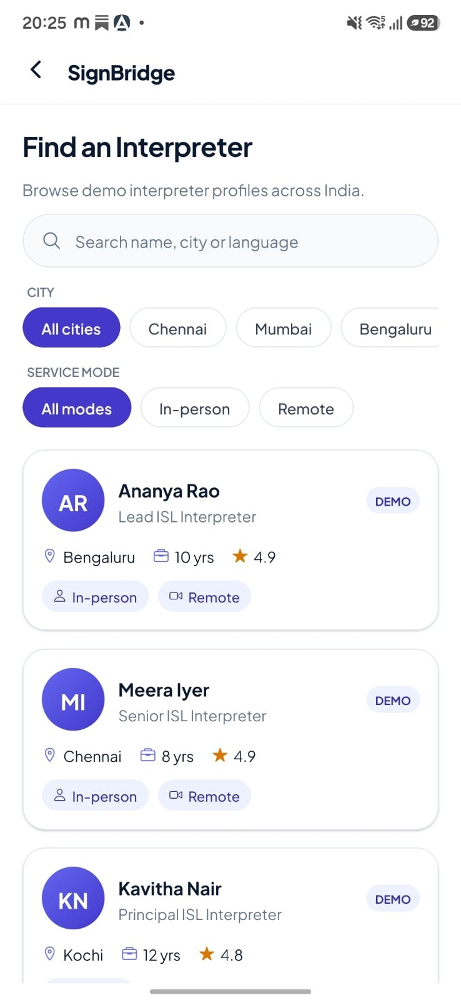
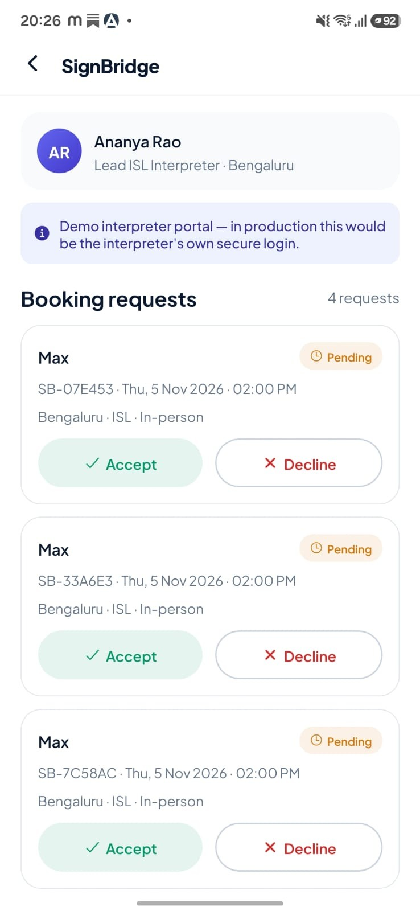
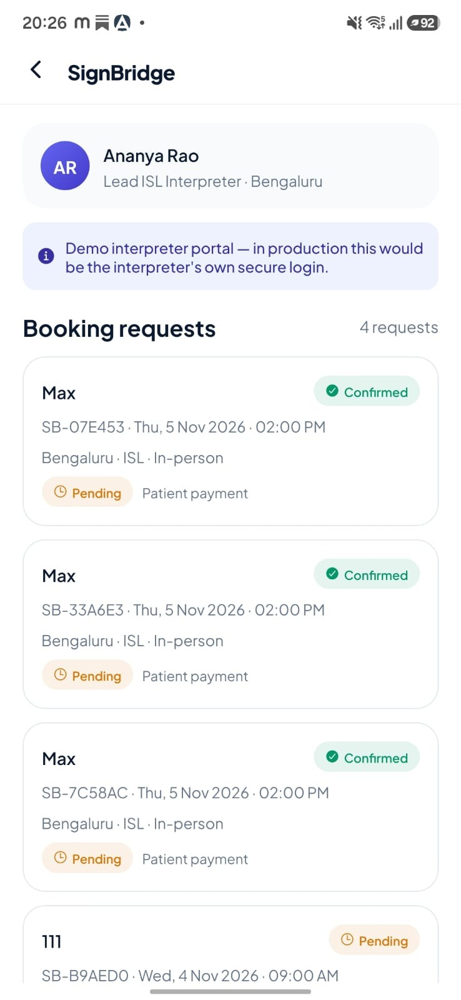
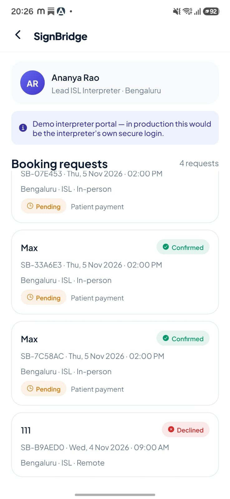

The App is built via Emergent ( Vibe Coded)

**Link** - https://app.emergent.sh/share-preview?app=exp%3A%2F%2Finterpret-care--715r7s2b.preview.emergentagent.com%3Fexpo_go_prompt_device_auth%3D1%26expo_go_device_auth_verification_uri_override%3Dapp.emergent.sh&job_id=984316c0-19b5-4d9d-935a-f1555c2790ff

The App can be previewed with **Expo Go App**

## Product walkthrough

The gallery below gives a compact overview of the prototype. Select any screen to view the full-size screenshot.

<table>
  <tr>
    <td align="center" width="33%">
       
      <strong>1. Home screen</strong>
    </td>
    <td align="center" width="33%">
       
      <strong>2. Interpreter discovery</strong>
    </td>
    <td align="center" width="33%">
       
      <strong>3. Interpreter profile</strong>
    </td>
  </tr>
  <tr>
    <td align="center" width="33%">
       
      <strong>4. Booking requests</strong>
    </td>
    <td align="center" width="33%">
       
      <strong>5. Confirmed bookings</strong>
    </td>
    <td align="center" width="33%">
       
      <strong>6. Booking statuses</strong>
    </td>
  </tr>
</table>
